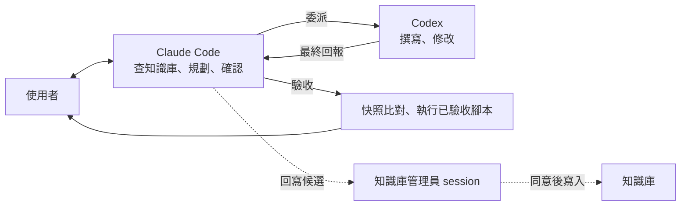

# Claude Code 與 Codex 分工

> 同時使用 [[Claude Code]] 與 [[Codex]] 時的角色分配：Claude Code 負責查知識庫、規劃、與使用者確認、驗收；Codex 負責實際撰寫與修改程式。本頁是「AI 協作」領域的入口，放在領域根目錄；其他頁依類別放在子資料夾（`委派/`、`驗收/`、`token 管理/`、`工具/`、`角色/`），並以 `up` 指回這裡。

## 解決什麼問題

- 兩個 agent 各自讀寫知識庫，規範與內容容易分歧。
- 不分主從時，使用者要自己在兩個 session 間切換、轉述需求。
- token 與 Codex 額度花在重複讀檔與進度回報，而不是實際工作。

## 做法

| 角色 | 負責 | 不做 |
| --- | --- | --- |
| Claude Code | 查知識庫、釐清規格（一次問完）、寫任務說明、[[委派 Codex 流程\|委派]]、[[委派驗收與工作區快照\|驗收]]、回報、提出知識庫回寫候選 | 逐條轉述 Codex 進度（見 [[token 節省原則]]） |
| Codex | 依任務說明與指定的知識庫頁面實作、回報「知識庫回寫候選」 | 寫入知識庫、commit、切分支、改用任務沒允許的做法 |
| 使用者 | 決定規格與數值、同意回寫、執行需要 GUI 的步驟、commit | — |

規則：
1. 知識只維護一份：Codex 以轉址檔讀 Claude 的指引（見 [[Codex#指引與 skill 的轉址]]）。
2. 委派一律走 `/delegate` skill，不用 `/codex:rescue`（經子代理轉呼叫，較耗 token）。
3. **Codex 做不到的工作由 Claude Code 接手**（例：sandbox 內無法操作 GUI 或 Office）。接手後第一次修改檔案前，先向使用者說明做法並取得同意。
4. 知識庫寫入只由「知識庫管理員」session（名稱 `Library`） 在使用者同意後執行；專案 session 提出回寫候選並共同整理（見 [[_meta/流程/回寫協作]]）。

## 角色

Claude Code session 依角色開在不同目錄，職責、開工必讀與交接規則寫在各角色頁（`角色/`，tag `流程/角色`）：

| 角色 | session 名稱 | 開在 | 負責 |
| --- | --- | --- | --- |
| [[知識庫管理員]] | `Library` | vault | 整理、健康檢查、跨頁查詢、所有知識庫寫入 |
| [[專案工程師]] | `<Project> - <role>`（例 `<Project> - dev`、`<Project> - writer`；同一個專案的各角色 `<Project>` 寫法要完全一致） | 專案目錄 | （範本，建立時填寫；有上下游分工時複製成兩個角色，例：開發類、文件類） |

交界規則的寫法（新專案依實際情況填寫，範例是通用做法）：
- 兩個專案之間的資料格式由產生資料的一方負責，改動時發「格式變更通知」給使用資料的一方；使用方不改產生方的程式。
- 兩邊共用的程式庫預設都不改；要改先由使用者決定，改完通知另一邊。
- 產出交付物（例：匯出、發布）由產生方做；commit 由使用者做。
- 兩邊結果的一致性比對由使用方做，產生方提供基準數字並註明口徑。
- **已驗收的腳本由工程師直接執行**，Codex 負責寫與改程式、腳本，以及異常診斷。執行時四條規則：只跑已驗收的腳本（不寫臨時內嵌腳本，需要新檢查就請 Codex 寫成腳本）；只讀總表；長時間執行放背景、不輪詢；異常不自己修，把異常原文交給 Codex。
- 高風險修改另審查一次，**審查者不是寫程式的一方**：Codex 寫的由工程師跑 `/code-review`，Claude 寫的（例外情況）可委派 Codex 唯讀審查。
- 每個專案一張工作分配表（`專案/<專案>/NN-分配 Claude 與 Codex 的工作.md`），每類工作項固定由 Claude、Codex 或使用者執行；同一類工作不換人，改派要先改表。

## 取捨

| 優點 | 缺點 |
| --- | --- |
| 知識庫與規範只有一份 | Claude Code 規劃與驗收本身要花 token |
| 使用者只和 Claude Code 對話 | Codex 只能被 Claude 呼叫，不能反向主導 |
| 驗收不依賴 Codex 自述 | Codex 的 sandbox 限制要由 Claude 補位 |

## 注意事項

> [!danger] 注意
> - Codex 回報「未修改」不代表檔案沒變，驗收一律以快照比對為準（[[委派驗收與工作區快照]]）。
> - 在未提交改動上疊加委派，驗收時難以分辨誰改了什麼；工作區改動多時，先 commit 或開 worktree 再委派。

## 相關

- [[委派 Codex 流程]]
- [[委派驗收與工作區快照]]
- [[token 節省原則]]
- [[Claude Code]]
- [[Codex]]
- [[知識庫管理員]]、[[專案工程師]]（角色頁）
- [[艾莉絲摘要]]
