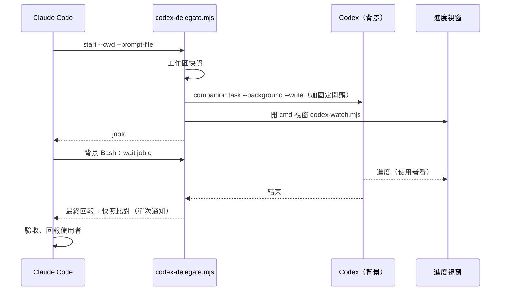

# 委派 Codex 流程

> Claude Code 把實作交給 [[Codex]] 在背景執行的標準步驟，由 `/delegate` skill 與 `codex-delegate.mjs` 腳本實作。一次指令完成快照、啟動、開進度視窗，結束時一次取回回報與比對結果。

> [!note]
> 本頁說明做法與原因；實際執行步驟、參數與固定開頭以 `{{USERPROFILE}}/.claude/skills/delegate/SKILL.md` 和 `{{USERPROFILE}}/.claude/scripts/codex-delegate.mjs` 為準。兩者不一致時先改 skill，再回來更新本頁。

## 解決什麼問題

- 用 `/codex:rescue` 會先啟動子代理再轉呼叫 Codex，子代理只執行一行指令也要花約 2 萬 token。
- Codex 在任務說明提到知識庫時會自動套用 `$kb` 並讀完整規範檔，即使任務已給了頁面路徑。
- 手動備份、手動開進度視窗、手動找任務紀錄，每次都要重做。

## 做法



1. **規劃**：規格不明時一次問完；查知識庫只讀相關章節。
2. **寫任務說明**到檔案：目標 repo 與分支、知識庫頁面完整路徑、已確認規格、限制、基準狀態（已知失敗的測試）、判定標準、回報格式。執行方式照下方「委派規則」。
3. **啟動**：
   ```bash
   node {{USERPROFILE}}/.claude/scripts/codex-delegate.mjs start --cwd <repo> --prompt-file <任務說明.md> --label "<任務名>" [--track <二進位檔>] [--resume] [--effort low|high] [--read-only]
   ```
4. **等待**：以背景 Bash 執行 `codex-delegate.mjs wait <jobId>`，結束本回合；Claude 只在結束時被叫醒一次做驗收。
5. **驗收與回報**：見 [[委派驗收與工作區快照]]。

腳本自動加在任務說明前的固定開頭：
- 直接讀指定頁面，不執行 `$kb`、不讀知識庫的 `CLAUDE.md`，不載入無關 skill。
- 不寫知識庫，回寫候選列在回報中。
- 不 commit、不切分支、不 stash / reset / checkout，不改寫既有未提交改動。
- 做不到時停下回報，不改用未允許的做法。
- 回報附測試指令與結果。

參數選擇：
| 參數 | 何時用 |
| --- | --- |
| `--track` | 要監控的未修改檔案，特別是二進位檔 |
| `--resume` | 延續同一 repo 上一個 Codex 對話（追問、修正） |
| `--effort low` | 步驟完全明確、出錯影響小的任務；容易出錯或複雜的任務用 `high` |
| `--read-only` | 只要 Codex 調查或回答，不修改 |
| `--label` | 通知與任務總表顯示的名稱，一律填寫 |

### 委派規則

原則：**正確率優先，節省為輔**。任何做法只要可能增加出錯，就不採用；驗證（一致性檢查、多次量測、驗收看 diff）一律不刪減。

| 規則 | 對正確率 | 附帶效果 |
| --- | --- | --- |
| 任務說明附上已確認的事實與段落層級的頁面引用 | 提高：少重新摸索、少讀錯 | 開頭較快 |
| 新腳本或新參數組先用小樣本試跑，確認輸出正確再跑正式量 | 提高：錯誤早發現 | 避免整批跑錯 |
| 長任務分階段，每階段結果寫檔 | 提高：中斷不遺失、可接續 | 中斷時省最多 |
| 同一批試算寫成一個腳本一次跑完，完整結果寫檔、終端只印摘要表 | 不變：結果都在檔案裡可查 | 指令數少，較快、較省 |
| 同一輪的程式修改合成一次委派；**不相關的工作不硬合併** | 不變；硬合併會增加出錯 | 總時間較短 |
| 只有同一件事的追問才用 `--resume`，其他開新對話 | 不變：不帶入無關的舊內容 | 通常打平或較快 |
| **工作可分工就分階段**：每階段開一次新的 Codex 對話，靠檔案交接；階段之間由 Claude 驗收 | 提高：每段範圍小、驗收點多 | 新對話不背著前段累積的內容重送 |
| 單次指令輸出不超過約 2,000 字元；要看結果檔就只取需要的欄位 | 不變：完整結果仍在檔案 | 省最大宗的重送 |
| 多組候選參數寫成參數檔，交給同一支腳本一次跑 | 不變：參數與結果都留檔、可重現 | 指令輪數大幅減少 |
| 程式碼位置直接給到檔案與行號，寫明不需要全域搜尋 repo | 提高：少讀錯地方 | 每輪少重送 |
| 內容已確定的說明文件小修改由 Claude 直接改，程式檔即使一行仍委派 | 不變 | 改檔的委派通常約 1M 輸入 token；只跑既有腳本的確認任務約 0.1～0.3M |

成本結構（實測）：Codex 每執行一個指令就重送整段對話，花費 ≈ 輪數 × 當時的對話長度；越早進入對話的內容重送越多輪。大宗通常是讀檔與搜尋、整份印出的結果、內嵌腳本與固定開頭。

### 完成通知與任務總表

| 工具 | 效果 |
| --- | --- |
| 任務看板（`/board`） | 本機網頁：任務清單、狀態、經過時間、最終回報、工作區比對、Codex 剩餘額度 |
| 進度視窗（`codex-watch.mjs`） | 結束時標題改為「完成 / 未完成」、印出耗時與失敗原因 |
| Windows 通知（`codex-notify.mjs`） | 通知「Codex 完成 / 未完成」與任務名稱 |
| 任務總表（`codex-jobs.mjs`） | 列出所有委派任務的狀態與耗時 |

- 外掛會把「額度用完、中途失敗」記成 `completed`；上述工具讀 log 中的 `Codex error` / `Turn failed` 判定為失敗並顯示原因。

## 取捨

| 優點 | 缺點 |
| --- | --- |
| 不經子代理，每次省約 2 萬 token | 依賴 codex-plugin-cc 的 companion 腳本與任務紀錄格式，外掛更新可能要調整 |
| 快照、進度、回報自動化 | 腳本針對 Windows 撰寫 |
| 固定開頭讓 Codex 跳過重複讀檔 | 固定規則寫在腳本內，修改要改程式 |

## 注意事項

> [!danger] 注意
> - codex-plugin-cc 的任務紀錄依工作目錄分開存放：`/codex:status` 要在目標 repo 目錄執行才查得到。
> - 需要 GUI、Office 或桌面環境的步驟不要委派，Codex 的 Windows sandbox 會卡住。
> - Codex 一次改多個檔案時，使用者正在跑的 dev watch 可能建出過期 bundle，回報時提醒重啟。
> - **取消任務不會結束 Codex 已啟動的子行程**：取消後以指令列找出殘留行程並結束。
> - **不要用背景 `sleep` 排程啟動委派**：停掉啟動器後，時間到仍可能啟動委派。已啟動的委派要終止時，從任務紀錄 `jobs/<jobId>.json` 取 `pid`，用 PowerShell `taskkill /PID <pid> /T /F`（Git Bash 會把 `/PID` 轉成路徑）；companion 的 cancel 在目標行程已不存在時不會寫入狀態，要另外把狀態標為 `cancelled`，並結束殘留的 `wait`。
> - 取消後用 `--resume` 延續同一對話會立刻失敗；改開新對話。
> - **`--read-only` 也會擋住 repo 外的寫入**；**`--resume` 會沿用上一個對話的 sandbox 設定**，要改權限就開新對話。
> - `codex-watch.mjs <jobId> --all` 會持續輸出不結束，不要在 Claude 的前景指令執行。
> - 長時間量測先用小樣本估時，超過使用者給的上限就縮小樣本再啟動。

## 相關

- [[Claude Code 與 Codex 分工]]
- [[委派驗收與工作區快照]]
- [[token 節省原則]]
- [[Codex]]
- [[Claude Code]]
